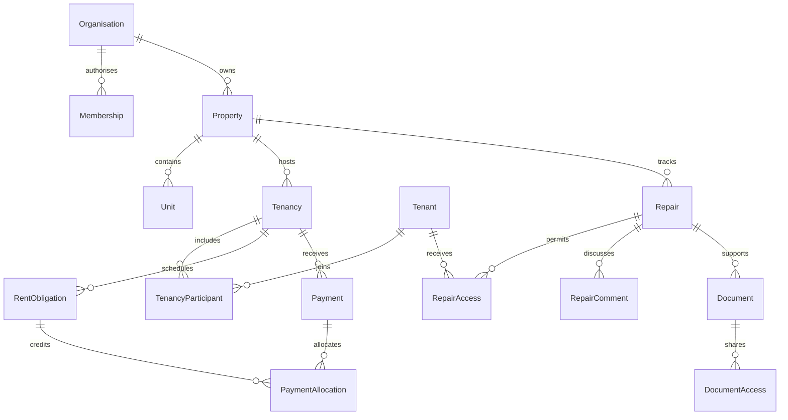

# Architecture

## Application boundaries

Next.js App Router renders public pages and authenticated workspaces. Better Auth owns password hashing, verification, reset tokens, persistent sessions and TOTP. Route handlers are deliberately thin: authenticate, validate request origin, validate input, invoke a domain service and translate errors.

`src/server/context.ts` derives organisation and role from a verified server session and an active membership. A cookie may select an organisation; it never grants access. Staff permissions distinguish read/write by domain and can restrict properties. Owner/stakeholder access is separately constrained. Platform administration checks an independently stored flag and requires two-factor authentication in production.

Core service domains: repairs, ledger, documents, onboarding/invitations, subscriptions, notifications, imports, reports and background processing. `resources.ts` dispatches typed CRUD for property operations. Shared form definitions and presentation components connect those services to the landlord and tenant portals.

## Data model

Core identities, organisation membership, property/unit structure, tenants, tenancy participants, rent obligations, payments/allocations, repairs/access/comments/updates, document access, expenses, compliance/history, deposits, listings/applicants, subscriptions and job/audit records are relational PostgreSQL tables.

Composite foreign keys bind linked records to the same organisation. Additional SQL constraints prevent negative amounts, invalid tenancy dates and allocations across different tenancies or beyond payment/obligation totals. Financial allocations and imports use serializable transactions. Property, unit and storage quotas lock the organisation row before counting and creating records.

Versioned `OperationRecord` payloads store bounded, Zod-validated structures for inventories, transition checklists, EPC plans, forecasts, feedback, guarantors, manual bank records and rental passport entries. This is intentionally a smaller schema than one table for every item in the brief. It should be split into additional relational domain models as richer workflows are developed.

## Repair privacy

Every repair query uses organisation scope. Tenant queries add reporting-tenant identity or an explicit repair grant. Landlord repairs start private. Sharing with occupants materialises grants for current affected occupants; later occupants do not inherit access automatically. Landlords may share again to update the audience. Reporters retain their own requests when other access is revoked.

Tenant detail responses are explicitly projected: no internal notes, costs, supplier data, private comments or audit metadata. Attachments require both an explicit document grant and access to the underlying repair. The same rule applies to lists, direct downloads and property document links. Notification delivery rechecks current access; obsolete queued emails are cancelled.

## Financial semantics

Amounts are integer pence. Rent obligations are independent records with unique schedule keys. Received payments allocate oldest-first and retain unapplied excess credit. Future schedule generation reallocates that credit. Payment recording is idempotent. Future rent changes retain a dated history and never overwrite past or allocated obligations. Changing payment frequency through a rent-change workflow is not implemented.

Reports use cash receipts and recorded expenses; arrears are computed at the selected end date. They are administrative summaries, not authoritative tax returns. Forecasts are deterministic calculations of user-supplied vacancy, costs and growth assumptions.

## Jobs and integrations

The PostgreSQL outbox uses unique deduplication keys, atomic claims, bounded retries, backoff and stale-lock recovery. The supplied worker processes a bounded batch, suitable for an external scheduler. Resend receives provider idempotency keys. Subscription webhooks verify Stripe signatures and record event IDs atomically with subscription updates.

Stripe Billing never processes tenant rent. Regulated rent collection, signatures, referencing, banking, tax, advertising portals and optional analysis use typed unconfigured adapters until a provider implementation is genuinely added. They cannot report fabricated success.

## Configuration

Branding is in `src/lib/config.ts`; credentials are environment variables. Local storage and sample plans explicitly reject production use. Administrator-reviewed compliance rules include version, jurisdiction, property type, effective dates and source. No legal requirements or precise failure probabilities are fabricated.
